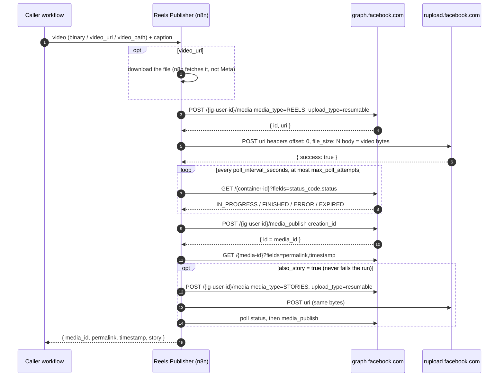

# Publish Instagram Reels (and video Stories) from n8n: the resumable-upload way

**English** · [Türkçe](README.tr.md)

[](https://n8n.io)
[](https://developers.facebook.com/docs/instagram-platform/content-publishing/)
[](#requirements)
[](LICENSE)

> **Getting error 2207077 or "The media could not be fetched from this uri" when you post a Reel from n8n?**
> The problem is Meta downloading the video from your n8n server. This workflow uploads the file
> to Meta directly instead, so there is no public URL for Meta to fetch.

A reusable n8n sub-workflow. You give it a video (binary, URL or file path) and a caption. It publishes a **Reel**,
waits until Meta has processed it and returns the `media_id` and `permalink`. It can also post the same file as a
**Story**. It was extracted from a workflow that publishes a weekly reel for a local restaurant in production.

---

## Why posting from n8n fails

The usual approach is to create a media container with `video_url=https://your-n8n/webhook/...`. Meta's docs say
*"We cURL the video using the passed-in URL, so it must be on a public server."* In our setup that did not work:

- Meta's fetcher sent a `HEAD` request first. The n8n webhook only answered `GET`, so it returned **404**.
- The `GET` response had no `Content-Length` header and no `Range` support.
- The container ended with `status_code=ERROR`, and `status` contained subcode **2207077**. That subcode is not in
  Meta's public error table. The documented one for unreachable URLs is **2207052** (*"The media could not be
  fetched from this uri"*).

You could try to fix this with a CDN, an S3 bucket or a better file server. It is easier to not rely on Meta
fetching anything.

## The fix: resumable upload

The Instagram Graph API also has an upload mode where **you send the bytes to Meta**:

1. `POST /{ig-user-id}/media` with `media_type=REELS&upload_type=resumable`. Meta returns `{ "id", "uri" }`, and the
   `uri` is on `rupload.facebook.com`.
2. `POST` the raw video to that `uri` with the headers `offset: 0` and `file_size: <bytes>`.
3. Poll the container's `status_code` until it is `FINISHED`.
4. `POST /{ig-user-id}/media_publish?creation_id=<container id>`, then read the `permalink`.

The Facebook Graph API credential in n8n adds `access_token` as a query parameter to every request. In production
that was **all the authentication rupload needed**. No extra `Authorization` header was required.

## How it works



On the canvas, these steps are grouped into four sections, each with a sticky note:

- **Input**: `Execute Workflow Trigger` (for other workflows) or `Manual Test` with `Test Input`, then `Config`,
  `Normalize Input` and an optional `Download Video`.
- **Reel**: create the container, attach the binary, upload it to rupload, then a **polling loop**:
  `Wait → Get Reel Status → Evaluate → Router`. The router sends the item to *finished* (publish), *pending* (wait
  again) or *failed / timeout* (`Stop and Error` with Meta's status text).
- **Story** (optional): the same flow with `media_type=STORIES`. Every error is caught and reported.
- **Output**: one item, `{ media_id, permalink, timestamp, story }`.

## Features

- **No public video URL needed.** Meta never downloads from your server, so you don't need tunnels, S3 or CORS setup.
- **Three input modes**: incoming binary, `video_url` (n8n downloads it), or `video_path` on the n8n host.
- **Clean polling loop** instead of a chain of copy-pasted Wait nodes. It stops early on `ERROR`/`EXPIRED` and has a
  configurable timeout.
- **Clear errors.** The run fails with Meta's own `status_code` / `status` and the container ID.
- **Optional Story** of the same file. A story failure never breaks the reel result: you get `story.ok = false` and
  a reason instead.
- **Checks input first**, using limits from Meta's documentation: caption length, hashtag and mention counts, file
  size, `thumb_offset`.
- **Portable.** All settings are in one `Config` node, and the token stays in an n8n credential.

## Requirements

- Self-hosted **n8n 2.x** (built and run on the Docker image `n8nio/n8n`).
- An Instagram **professional account** (Business or Creator) linked to a **Facebook Page**, and a Meta app.
- An access token with the permissions listed below, stored in n8n as a **Facebook Graph API** credential.
- Only for `video_path` input: `NODE_FUNCTION_ALLOW_BUILTIN=fs`. If you run n8n with external task runners, set it
  on the runner.
- The video must match Meta's Reels spec: MP4/MOV, H.264 or HEVC, AAC audio, 23–60 fps, 3 s to 15 min, ≤ 300 MB,
  9:16 recommended, moov atom at the front.

## Quick start

### 1. Import

In n8n: **Workflows → Import from File** → `workflows/instagram-reels-publisher.json`.
If you want the demo, also import `workflows/example-caller.json`.

### 2. Credential

| Credential type (n8n) | Used by | How to get it |
|---|---|---|
| **Facebook Graph API** (`facebookGraphApi`, access token) | All *Facebook Graph API* nodes, plus the HTTP Request nodes **Upload Reel Video** and **Upload Story Video** | Create a token in Meta's [Graph API Explorer](https://developers.facebook.com/tools/explorer/) for your app, with the permissions below. Exchange it for a [long-lived token](https://developers.facebook.com/docs/facebook-login/guides/access-tokens/get-long-lived). |

Permissions for *Instagram API with Facebook Login*, per Meta's content-publishing docs:

| Permission | Why |
|---|---|
| `instagram_basic` | read the account and containers |
| `instagram_content_publish` | create containers and publish |
| `pages_read_engagement` | required by Meta for publishing with Facebook Login |
| `pages_show_list` | only to look up your IDs (step 3) |
| `ads_management`, `ads_read` | only if your Page role comes from Business Manager |

About the token type: Meta's content-publishing guide asks for a Page access token, and the IG User Media reference
lists a User token. Long-lived User tokens *"generally last about 60 days"*. Long-lived Page tokens *"do not have an
expiration date"* and are only invalidated under certain conditions. See Meta's
[long-lived token docs](https://developers.facebook.com/docs/facebook-login/guides/access-tokens/get-long-lived)
for both.

### 3. Config

Open the **Config** node and set `ig_user_id`. To find it:

```
GET /me/accounts                                   -> your Pages and their IDs
GET /{page-id}?fields=instagram_business_account   -> { "instagram_business_account": { "id": "<ig_user_id>" } }
```

You can run both calls in the Graph API Explorer. The ID is a long number, and it is different from your Page ID and
your @handle.

| Key | Default | Meaning |
|---|---|---|
| `ig_user_id` | `YOUR_IG_USER_ID` | Numeric ID of the Instagram professional account. |
| `graph_version` | `v23.0` | Graph API version for all `graph.facebook.com` calls. This is the version used in production. The rupload URL comes from Meta's response. |
| `poll_interval_seconds` | `60` | Pause between status checks. Meta recommends checking *"once per minute, for no more than 5 minutes"*. **Keep it below 65** (see Lessons learned). |
| `max_poll_attempts` | `6` | Reel status checks before the run stops with a timeout (6 × 60 s = the 6-minute budget used in production). |
| `story_max_poll_attempts` | `3` | Story status checks before the story is reported as timed out. |
| `http_timeout_ms` | `300000` | Timeout for the download and for each rupload POST. |
| `max_reel_mb` | `300` | Reels file-size limit from Meta's spec (1 MB = 1,000,000 bytes). Larger files fail before any API call. |
| `max_story_mb` | `100` | Stories file-size limit from Meta's spec. Larger files skip the story with a reason. The reel is still published. |
| `allowed_video_dir` | `/data/downloads` | `video_path` must be inside this folder. |

There is no time zone setting. The workflow doesn't schedule or format dates. If you add a schedule in a caller, set
`GENERIC_TIMEZONE` or the workflow's time zone yourself.

### 4. Test

Open **Test Input** and put a direct link to a vertical MP4 in `video_url`. Adjust the caption, then run the
workflow from **Manual Test**. **This posts a real Reel** to the account in `ig_user_id`.

### 5. Use it from your workflows

Add an **Execute Sub-workflow** node: *Source: Database*, pick **Instagram Reels Publisher (resumable upload)**,
*Mode: Run once with all items*, and leave *Wait For Sub-Workflow Completion* on. The trigger is set to
**Accept all data**, so whatever item you send arrives unchanged, binary included. `example-caller.json` shows the
whole pattern: download → add options → call.

One execution publishes **one** reel (the first input item). To post several videos, put a *Loop Over Items* node in
front of the call.

**Publish the publisher workflow.** In n8n 2.x, a production run of your caller (schedule, webhook and so on) executes
the sub-workflow's *published* version. If it has never been published, the call fails with *"Workflow is not active
and cannot be executed."* After you edit the publisher, publish it again, or callers keep running the old version.
Manual test runs use the draft.

If the caller is owned by a different user or project, open the publisher's **Settings → This workflow can be called
by** and allow it.

## Input / output contract

**Input** (fields on the first item):

| Field | Type | Default | Notes |
|---|---|---|---|
| *binary* | binary | none | The video. The workflow uses `binary_property` if you set it, otherwise `video`, then `data`, then the only binary property. |
| `binary_property` | string | auto | Name of the binary property that holds the video. |
| `video_url` | string | none | Used when there is no binary. n8n downloads the file. Meta never sees this URL. |
| `video_path` | string | none | Used when there is no binary and no URL. Must be inside `allowed_video_dir`, and needs `NODE_FUNCTION_ALLOW_BUILTIN=fs`. |
| `caption` | string | `""` | Up to 2200 characters, 30 hashtags and 20 @mentions (Meta's limits, checked before upload). |
| `share_to_feed` | boolean | `true` | `false` = the reel appears only in the Reels tab. |
| `also_story` | boolean | `false` | Also post the same file as a Story. |
| `cover_url` | string | none | Public image URL for the Reels cover. **Meta downloads this one**, so it must be publicly reachable. If you set both, `cover_url` wins over `thumb_offset`. |
| `thumb_offset` | integer (ms) | none | Frame to use as the cover thumbnail. Ignored if `cover_url` is set. |

**Output** (one item):

```json
{
  "media_id": "<published reel id>",
  "permalink": "https://www.instagram.com/reel/.../",
  "timestamp": "2026-01-01T12:00:00+0000",
  "story": { "ok": true, "media_id": "<story id>" }
}
```

| Field | Notes |
|---|---|
| `media_id` | Always set when the run succeeds. |
| `permalink`, `timestamp` | `null` if the lookup after publishing failed. The reel is still live. |
| `story` | `null` if you didn't ask for a story, `{ "ok": true, "media_id" }` if it worked, `{ "ok": false, "error": "..." }` if it failed or was skipped (e.g. file > `max_story_mb`). |

**The run fails** (so the Execute Sub-workflow node in your caller fails too) when the input or Config is invalid,
the download fails, container creation or upload fails, the reel container ends `ERROR`/`EXPIRED` or doesn't reach
`FINISHED` within `max_poll_attempts`, or `media_publish` fails. Story problems never fail the run.

## Lessons learned in production

- **Don't make Meta fetch from n8n.** A webhook that serves a file answers `GET` only (so `HEAD` gets a 404), and its
  response has no `Content-Length` and no `Range` support. Meta's fetcher gave up on it with 2207077. Resumable upload
  avoids the fetch completely.
- **The n8n credential is enough for rupload.** Meta's curl examples use `Authorization: OAuth <token>`. The
  `?access_token=` query parameter that n8n's Facebook Graph API credential adds worked in production. The only
  headers we send are `offset: 0` and `file_size`.
- **Poll the status instead of waiting a fixed time.** Processing time varies. Stopping right away on
  `ERROR`/`EXPIRED` also shows you Meta's reason immediately.
- **Keep each wait under 65 seconds.** n8n keeps waits shorter than 65 s in memory. Longer waits put the execution
  into a *waiting* state in the database, and community reports show parent workflows sometimes treating a waiting
  sub-workflow as finished.
- **A story failure must not fail the run.** By then the reel is already public. If a story error failed the run, a
  retry or error handler could publish the reel a second time. That's why the story branch reports errors instead of
  throwing them.
- **Upload the video itself as the story.** The Graph API can't add the in-app "share reel to story" sticker, and
  Meta's docs say stickers aren't supported for API stories. Stories also have tighter limits: ≤ 100 MB and
  ≤ 60 seconds. The production workflow capped its reels at ~95 MB so that the same file always fit both limits.
- **Uploads can be slow or flaky.** Both upload nodes retry 3 times with a 5-second pause and use a 5-minute timeout.

## Troubleshooting

Meanings are quoted from Meta's [error code table](https://developers.facebook.com/docs/instagram-platform/instagram-graph-api/reference/error-codes),
except where marked.

| Symptom | Meaning | What to do |
|---|---|---|
| Container `ERROR`, `status` shows **2207077** | *Not in Meta's table.* We got it when Meta couldn't fetch a `video_url` from n8n. | Use this workflow (resumable upload) instead of `video_url`. |
| **2207052** (code 9004) | "The media could not be fetched from this uri" | With this workflow the video is never fetched. Check that your `cover_url` is public. |
| **2207026** (code 352) | "The video format is not supported" | Re-encode to the spec: H.264/HEVC + AAC in MP4, moov atom at the front (ffmpeg: `-movflags +faststart`). |
| **2207027** (code 9007) | "The media is not ready for publishing, please wait." | Publish only after `FINISHED`. The workflow already polls; raise `max_poll_attempts`. |
| **2207020** (code -2) | "The media you are trying to access has expired." | Create a new container. Every run of this workflow does. |
| **2207042** (code 9) | "You reached maximum number of posts that is allowed" | Wait for the rolling 24-hour window. Check `GET /{ig-user-id}/content_publishing_limit`. |
| **2207050** (code 25) | "The Instagram account is restricted." | Resolve it in the Instagram app first. |
| **2207051** (code 4) | "We restrict certain activity to protect our community." | Meta flagged the activity as possible spam. Slow down and check the account. |
| **2207032** / **2207053** / **2207001** (code -1) | "Create media fail, please try to re-create media" / "unknown upload error" / server error | Temporary. Run again (it creates a new container). |
| `Reel container ... is still IN_PROGRESS after N checks` | This workflow's timeout | Large or long video. Raise `max_poll_attempts`. The container can still be published for 24 h. |
| `Meta did not return an upload URI` | The container call didn't return `uri` | Check `ig_user_id`, token permissions and `graph_version`. |
| *Upload Reel Video* fails with an auth error | rupload rejected the token | Check the token first. If Meta ever stops accepting `access_token` there, switch both upload nodes to a **Header Auth** credential (`Authorization` = `OAuth <token>`). |
| `Workflow is not active and cannot be executed.` (in the caller) | The publisher has no published version | Publish the publisher workflow, and publish it again after every edit. |
| `video_path needs the fs module` | `require('fs')` is blocked | Set `NODE_FUNCTION_ALLOW_BUILTIN=fs`, or pass binary / `video_url` instead. |
| Caller continues before the reel is published | The sub-workflow went into a *waiting* state | Keep `poll_interval_seconds` below 65. |

## Limitations

- One reel per execution. Reels can't go into carousels.
- Stories: no stickers (link, poll, location), no caption. The story is a separate upload, not a "share" of the reel.
- Meta's publishing limits apply. The content-publishing guide says 100 API-published posts per rolling 24 h, and the
  `media_publish` reference says 50. Query `content_publishing_limit` to see your own. An account can create at most
  400 containers per rolling 24 h.
- Pages that require Page Publishing Authorization can't be published to until PPA is completed.
- The `Normalize Input` / `Prepare Upload` Code nodes load the video into memory once to measure it (only if n8n
  didn't record the size) or to read `video_path`. Plan memory for files up to 300 MB.
- The upload is sent in one request (`offset: 0`). An interrupted upload is not resumed; the node retries from the
  start instead.
- There is no built-in notification. Set an *Error Workflow* in the workflow settings if you want alerts.

## How it was tested

The Graph API and rupload requests (version, parameters, `offset` / `file_size` headers, binary body, credential)
are the same ones the production workflow sends to Meta. The reusable workflow around them was run on an isolated
n8n 2.41 against a local mock of `graph.facebook.com` and `rupload.facebook.com`. The mock runs covered the success
path with and without a story, a reel `ERROR`, a reel timeout, and each way the story can fail (container, upload,
status `ERROR`, status timeout, publish, file too big). They also covered all three input modes (including a call
from `example-caller.json`) and the input checks.

## Cost

The workflow uses no paid third-party service: only Meta's Graph API and your own n8n. The real limits are Meta's rate
limits (above) and the memory/bandwidth on your n8n host.

## References

- Meta: [Content publishing (Instagram Platform)](https://developers.facebook.com/docs/instagram-platform/content-publishing/): resumable upload, rupload headers, polling advice, limits, permissions
- Meta: [IG User Media reference](https://developers.facebook.com/docs/instagram-platform/instagram-graph-api/reference/ig-user/media): `upload_type`, `share_to_feed`, `cover_url`, `thumb_offset`, caption limits, Reels/Stories video specs, story limitations
- Meta: [IG Container reference](https://developers.facebook.com/docs/instagram-platform/instagram-graph-api/reference/ig-container): `status_code` values (`EXPIRED`, `ERROR`, `FINISHED`, `IN_PROGRESS`, `PUBLISHED`)
- Meta: [IG User Media Publish reference](https://developers.facebook.com/docs/instagram-platform/instagram-graph-api/reference/ig-user/media_publish)
- Meta: [Error codes](https://developers.facebook.com/docs/instagram-platform/instagram-graph-api/reference/error-codes)
- Meta: [Get started with Facebook Login (finding the IG user ID)](https://developers.facebook.com/docs/instagram-platform/instagram-api-with-facebook-login/get-started)
- Meta: [Long-lived access tokens](https://developers.facebook.com/docs/facebook-login/guides/access-tokens/get-long-lived)
- n8n: [Facebook Graph API credentials](https://docs.n8n.io/integrations/builtin/credentials/facebookgraph/)
- n8n: [Wait node](https://docs.n8n.io/integrations/builtin/core-nodes/n8n-nodes-base.wait/): waits under 65 s stay in memory
- n8n: [Execute Sub-workflow](https://docs.n8n.io/integrations/builtin/core-nodes/n8n-nodes-base.executeworkflow/)
- n8n: [Enable modules in Code node](https://docs.n8n.io/hosting/configuration/configuration-examples/modules-in-code-node/) (`NODE_FUNCTION_ALLOW_BUILTIN`)

## Contributing

Issues and PRs are welcome. That includes new Meta error codes you've seen, with the exact `status` text. Please
don't include tokens, account IDs or media IDs in issues or exported workflows.

## Related

Other n8n workflows from the same production setup:

- [n8n-instagram-autopilot](https://github.com/bugraskl/n8n-instagram-autopilot): food photos → judged, designed Instagram posts, stories and a weekly AI reel (this publisher is extracted from it)
- [n8n-grounded-blog-writer](https://github.com/bugraskl/n8n-grounded-blog-writer): a WordPress blog writer with trend signals, grounded research and a number checker
- [n8n-gmail-ai-labeler](https://github.com/bugraskl/n8n-gmail-ai-labeler): hourly Gmail labeling with a typed decision model

## License

[MIT](LICENSE)
