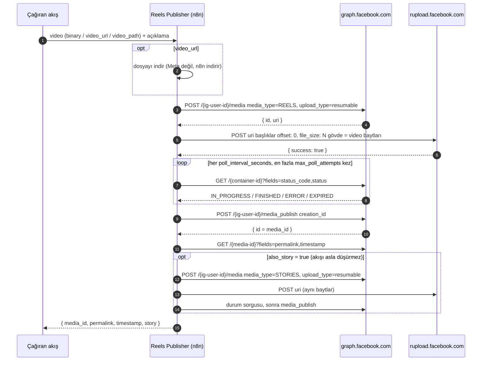

# n8n'den Instagram Reels (ve video Hikâye) paylaşmak: resumable upload yöntemi

[English](README.md) · **Türkçe**

[](https://n8n.io)
[](https://developers.facebook.com/docs/instagram-platform/content-publishing/)
[](#gereksinimler)
[](LICENSE)

> **n8n'den Reel paylaşırken 2207077 hatası ya da "The media could not be fetched from this uri" mı alıyorsunuz?**
> Sorun, Meta'nın videoyu n8n sunucunuzdan indirmeye çalışması. Bu akış dosyayı Meta'ya doğrudan yükler, yani
> Meta'nın indirmesi gereken herkese açık bir URL kalmaz.

Tekrar kullanılabilir bir n8n alt akışıdır. Ona bir video (binary, URL ya da dosya yolu) ve açıklama verirsiniz.
Akış bir **Reel** yayınlar, Meta işlemeyi bitirene kadar bekler ve `media_id` ile `permalink` değerlerini döndürür.
İsterseniz aynı dosyayı **Hikâye** olarak da paylaşır. Yerel bir restoran için her hafta canlıda reel yayınlayan bir
akıştan çıkarıldı.

---

## n8n'den paylaşım neden başarısız oluyor?

Bilinen yol, `video_url=https://n8n-adresiniz/webhook/...` ile bir medya konteyneri oluşturmaktır. Meta'nın
dokümantasyonu şöyle der: *"We cURL the video using the passed-in URL, so it must be on a public server."* Bizim
kurulumumuzda bu işe yaramadı:

- Meta önce `HEAD` isteği gönderdi. n8n webhook'u yalnızca `GET` kabul ettiği için **404** döndü.
- `GET` yanıtında `Content-Length` başlığı yoktu, `Range` desteği de yoktu.
- Konteyner `status_code=ERROR` ile bitti ve `status` alanında **2207077** alt kodu vardı. Bu kod Meta'nın herkese
  açık hata tablosunda yok. Erişilemeyen URL için belgelenmiş kod **2207052**'dir (*"The media could not be fetched
  from this uri"*).

Bunu CDN, S3 ya da daha iyi bir dosya sunucusuyla çözmeye çalışabilirsiniz. Meta'nın hiçbir şey indirmesine gerek
bırakmamak daha kolay.

## Çözüm: resumable upload

Instagram Graph API'de **baytları sizin Meta'ya gönderdiğiniz** bir yükleme modu da var:

1. `POST /{ig-user-id}/media`, parametreler `media_type=REELS&upload_type=resumable`. Meta `{ "id", "uri" }`
   döndürür; `uri` `rupload.facebook.com` üzerindedir.
2. Ham video bu `uri` adresine `POST` edilir. Başlıklar: `offset: 0` ve `file_size: <bayt>`.
3. Konteynerin `status_code` değeri `FINISHED` olana kadar düzenli olarak sorgulanır.
4. `POST /{ig-user-id}/media_publish?creation_id=<konteyner id>` çağrılır, ardından `permalink` okunur.

n8n'deki Facebook Graph API kimlik bilgisi her isteğe sorgu parametresi olarak `access_token` ekler. Canlıda
rupload için **gereken tek kimlik doğrulama buydu**. Ayrıca bir `Authorization` başlığına gerek kalmadı.

## Nasıl çalışır



Tuvalde bu adımlar dört bölüme ayrılmıştır ve her bölümün bir yapışkan notu vardır:

- **Girdi**: `Execute Workflow Trigger` (başka akışlar için) ya da `Manual Test` ile `Test Input`, ardından `Config`,
  `Normalize Input` ve gerekirse `Download Video`.
- **Reel**: konteyner oluşturulur, binary eklenir, rupload'a yüklenir, sonra bir **sorgulama döngüsü** çalışır:
  `Wait → Get Reel Status → Evaluate → Router`. Router öğeyi *finished* (yayınla), *pending* (tekrar bekle) ya da
  *failed / timeout* (Meta'nın durum metniyle `Stop and Error`) çıkışına yollar.
- **Hikâye** (isteğe bağlı): `media_type=STORIES` ile aynı akış. Her hata yakalanır ve raporlanır.
- **Çıktı**: tek öğe, `{ media_id, permalink, timestamp, story }`.

## Özellikler

- **Herkese açık video URL'si gerekmez.** Meta sunucunuzdan hiçbir şey indirmediği için tünel, S3 ya da CORS ayarına
  gerek kalmaz.
- **Üç girdi modu**: gelen binary, `video_url` (n8n indirir) ya da n8n sunucusundaki `video_path`.
- **Temiz bir sorgulama döngüsü.** Kopyala-yapıştır Wait zincirleri yerine tek döngü var. `ERROR`/`EXPIRED`
  durumunda hemen durur, zaman aşımı ayarlanabilir.
- **Anlaşılır hatalar.** Akış Meta'nın kendi `status_code` / `status` bilgisi ve konteyner ID'siyle durur.
- **İsteğe bağlı Hikâye.** Aynı dosya hikâye olarak da paylaşılabilir. Hikâye hatası reel sonucunu asla bozmaz:
  `story.ok = false` ve bir sebep döner.
- **Girdiyi önceden denetler.** Meta dokümantasyonundaki limitlere göre açıklama uzunluğu, hashtag ve etiket sayısı,
  dosya boyutu ve `thumb_offset` kontrol edilir.
- **Taşınabilir.** Tüm ayarlar tek bir `Config` düğümünde, token ise n8n kimlik bilgisinde durur.

## Gereksinimler

- Kendi sunucunuzda **n8n 2.x** (Docker imajı `n8nio/n8n` üzerinde geliştirildi ve çalışıyor).
- Bir **Facebook Sayfası**na bağlı Instagram **profesyonel hesabı** (İşletme ya da İçerik Üreticisi) ve bir Meta
  uygulaması.
- Aşağıdaki izinlere sahip bir erişim token'ı. n8n'e **Facebook Graph API** kimlik bilgisi olarak kaydedilir.
- Yalnızca `video_path` girdisi için: `NODE_FUNCTION_ALLOW_BUILTIN=fs`. n8n'i harici task runner'larla
  çalıştırıyorsanız bu değişkeni runner'a tanımlayın.
- Video, Meta'nın Reels spesifikasyonuna uymalı: MP4/MOV, H.264 ya da HEVC, AAC ses, 23–60 fps, 3 sn ile 15 dk arası,
  en fazla 300 MB, 9:16 önerilir, moov atom dosyanın başında olmalı.

## Hızlı başlangıç

### 1. İçe aktarın

n8n'de **Import from File** ile `workflows/instagram-reels-publisher.json` dosyasını açın. Demoyu da görmek
isterseniz `workflows/example-caller.json` dosyasını da içe aktarın.

### 2. Kimlik bilgisi

| Kimlik bilgisi türü (n8n) | Kullanan düğümler | Nasıl alınır |
|---|---|---|
| **Facebook Graph API** (`facebookGraphApi`, access token) | Tüm *Facebook Graph API* düğümleri, ayrıca HTTP Request düğümleri **Upload Reel Video** ve **Upload Story Video** | Meta'nın [Graph API Explorer](https://developers.facebook.com/tools/explorer/) aracında uygulamanız için aşağıdaki izinlerle token üretin. Sonra [uzun ömürlü token](https://developers.facebook.com/docs/facebook-login/guides/access-tokens/get-long-lived) ile değiştirin. |

Meta'nın içerik yayınlama dokümantasyonuna göre *Instagram API with Facebook Login* için gereken izinler:

| İzin | Neden |
|---|---|
| `instagram_basic` | hesabı ve konteynerleri okumak |
| `instagram_content_publish` | konteyner oluşturmak ve yayınlamak |
| `pages_read_engagement` | Facebook Login ile yayın için Meta bunu şart koşuyor |
| `pages_show_list` | yalnızca ID'leri bulmak için (3. adım) |
| `ads_management`, `ads_read` | yalnızca Sayfa rolünüz Business Manager üzerinden geliyorsa |

Token türü hakkında: Meta'nın içerik yayınlama rehberi Sayfa erişim token'ı istiyor, IG User Media referansı ise
Kullanıcı token'ı gösteriyor. Uzun ömürlü Kullanıcı token'ları *"generally last about 60 days"*, yani genelde yaklaşık
60 gün geçerlidir. Uzun ömürlü Sayfa token'larının ise *"do not have an expiration date"*: bir son kullanma tarihi
yoktur, yalnızca belirli durumlarda geçersiz olurlar. İkisi için de Meta'nın
[uzun ömürlü token dokümanına](https://developers.facebook.com/docs/facebook-login/guides/access-tokens/get-long-lived)
bakın.

### 3. Config

**Config** düğümünü açıp `ig_user_id` değerini girin. Bu değeri bulmak için:

```
GET /me/accounts                                   -> Sayfalarınız ve ID'leri
GET /{page-id}?fields=instagram_business_account   -> { "instagram_business_account": { "id": "<ig_user_id>" } }
```

İki çağrıyı da Graph API Explorer'da yapabilirsiniz. Bu ID uzun bir sayıdır; Sayfa ID'nizle de @kullanıcı adınızla
da aynı değildir.

| Anahtar | Varsayılan | Anlamı |
|---|---|---|
| `ig_user_id` | `YOUR_IG_USER_ID` | Instagram profesyonel hesabının sayısal ID'si. |
| `graph_version` | `v23.0` | Tüm `graph.facebook.com` çağrılarının Graph API sürümü. Canlıda kullanılan sürüm budur. rupload adresi Meta'nın yanıtından gelir. |
| `poll_interval_seconds` | `60` | Durum sorguları arasındaki bekleme. Meta'nın önerisi: *"once per minute, for no more than 5 minutes"*, yani dakikada bir ve en fazla 5 dakika. **65'in altında tutun** (bkz. Canlıdan dersler). |
| `max_poll_attempts` | `6` | Akış zaman aşımıyla durmadan önce reel durumu kaç kez sorgulanır (6 × 60 sn, canlıda kullanılan 6 dakikalık süre). |
| `story_max_poll_attempts` | `3` | Hikâye zaman aşımı sayılmadan önce kaç kez sorgulanır. |
| `http_timeout_ms` | `300000` | İndirme ve her rupload POST isteği için zaman aşımı. |
| `max_reel_mb` | `300` | Meta spesifikasyonundaki Reels dosya boyutu limiti (1 MB = 1.000.000 bayt). Daha büyük dosyalar API çağrısından önce durdurulur. |
| `max_story_mb` | `100` | Meta spesifikasyonundaki Hikâye limiti. Daha büyük dosyada hikâye sebebiyle birlikte atlanır; reel yine yayınlanır. |
| `allowed_video_dir` | `/data/downloads` | `video_path` bu klasörün içinde olmak zorunda. |

Saat dilimi ayarı yok. Akış zamanlama ya da tarih biçimlendirme yapmıyor. Çağıran akışa zamanlama eklerseniz
`GENERIC_TIMEZONE` değişkenini ya da akışın saat dilimini kendiniz ayarlayın.

### 4. Deneyin

**Test Input** düğümünde `video_url` alanına dikey bir MP4'ün doğrudan bağlantısını yazın. Açıklamayı düzenleyin ve
akışı **Manual Test** üzerinden çalıştırın. **Bu, `ig_user_id` hesabına gerçek bir Reel paylaşır.**

### 5. Kendi akışlarınızdan çağırın

Bir **Execute Sub-workflow** düğümü ekleyin: *Source: Database*, **Instagram Reels Publisher (resumable upload)**
akışını seçin, *Mode: Run once with all items* yapın ve *Wait For Sub-Workflow Completion* açık kalsın. Tetikleyici
**Accept all data** modunda olduğu için gönderdiğiniz öğe binary dahil olduğu gibi ulaşır. `example-caller.json`
bütün kalıbı gösterir: indir → seçenekleri ekle → çağır.

Bir çalıştırma **tek** reel yayınlar (ilk girdi öğesi). Birden fazla video için çağrının önüne *Loop Over Items*
koyun.

**Yayıncı akışı yayınlayın (publish).** n8n 2.x'te çağıran akışın canlı çalıştırmaları (zamanlayıcı, webhook vb.)
alt akışın *yayınlanmış* sürümünü çalıştırır. Hiç yayınlanmadıysa çağrı *"Workflow is not active and cannot be
executed."* hatası verir. Yayıncı akışı düzenledikten sonra tekrar yayınlayın, yoksa çağıranlar eski sürümü
çalıştırmaya devam eder. Elle yapılan test çalıştırmaları ise taslağı kullanır.

Çağıran akış başka bir kullanıcıya ya da projeye aitse, yayıncı akışın **Settings → This workflow can be called by**
ayarından izin verin.

## Girdi / çıktı sözleşmesi

**Girdi** (ilk öğedeki alanlar):

| Alan | Tür | Varsayılan | Not |
|---|---|---|---|
| *binary* | binary | yok | Video. Akış, ayarlandıysa `binary_property` değerini kullanır; yoksa sırasıyla `video`, `data` ya da tek binary özelliğe bakar. |
| `binary_property` | string | otomatik | Videoyu taşıyan binary özelliğin adı. |
| `video_url` | string | yok | Binary yoksa kullanılır. Dosyayı n8n indirir; Meta bu URL'yi hiç görmez. |
| `video_path` | string | yok | Binary ve URL yoksa kullanılır. `allowed_video_dir` içinde olmalı, `NODE_FUNCTION_ALLOW_BUILTIN=fs` gerekir. |
| `caption` | string | `""` | En fazla 2200 karakter, 30 hashtag ve 20 @etiket (Meta limitleri, yüklemeden önce denetlenir). |
| `share_to_feed` | boolean | `true` | `false` olursa reel yalnızca Reels sekmesinde görünür. |
| `also_story` | boolean | `false` | Aynı dosyayı Hikâye olarak da paylaşır. |
| `cover_url` | string | yok | Reels kapağı için herkese açık görsel URL'si. **Bunu Meta indirir**, o yüzden herkese açık olmalı. İkisi birden verilirse `cover_url`, `thumb_offset`'in önüne geçer. |
| `thumb_offset` | tam sayı (ms) | yok | Kapak küçük resmi olarak kullanılacak kare. `cover_url` varsa yok sayılır. |

**Çıktı** (tek öğe):

```json
{
  "media_id": "<yayınlanan reel id>",
  "permalink": "https://www.instagram.com/reel/.../",
  "timestamp": "2026-01-01T12:00:00+0000",
  "story": { "ok": true, "media_id": "<hikâye id>" }
}
```

| Alan | Not |
|---|---|
| `media_id` | Akış başarılıysa her zaman dolu. |
| `permalink`, `timestamp` | Yayından sonraki sorgu başarısız olduysa `null`. Reel yine de yayındadır. |
| `story` | Hikâye istenmediyse `null`. Başarılıysa `{ "ok": true, "media_id" }`. Başarısızsa ya da atlandıysa (ör. dosya > `max_story_mb`) `{ "ok": false, "error": "..." }`. |

**Akış hata verir** (dolayısıyla çağıran akıştaki Execute Sub-workflow düğümü de hata verir), şu durumlarda: girdi
ya da Config geçersizse, indirme başarısız olursa, konteyner oluşturma ya da yükleme başarısız olursa, reel
konteyneri `ERROR`/`EXPIRED` ile biterse ya da `max_poll_attempts` içinde `FINISHED` olmazsa, `media_publish`
başarısız olursa. Hikâye sorunları akışı asla düşürmez.

## Canlıdan dersler

- **Meta'ya n8n'den indirme yaptırmayın.** Dosya sunan bir webhook yalnızca `GET`'e yanıt verir (`HEAD` 404 alır),
  yanıtında `Content-Length` ve `Range` desteği de yoktur. Meta'nın indiricisi 2207077 ile vazgeçti. Resumable
  upload indirme adımını tamamen ortadan kaldırıyor.
- **rupload için n8n kimlik bilgisi yeterli.** Meta'nın curl örnekleri `Authorization: OAuth <token>` kullanıyor.
  n8n'in Facebook Graph API kimlik bilgisinin eklediği `?access_token=` sorgu parametresi canlıda çalıştı.
  Gönderdiğimiz başlıklar yalnızca `offset: 0` ve `file_size`.
- **Sabit süre beklemek yerine durumu sorgulayın.** İşleme süresi değişkendir. `ERROR`/`EXPIRED` durumunda hemen
  durmak, Meta'nın sebebini de hemen gösterir.
- **Her beklemeyi 65 saniyenin altında tutun.** n8n 65 sn'den kısa beklemeleri bellekte tutar. Daha uzun beklemeler
  çalıştırmayı veritabanında *waiting* durumuna geçirir. Topluluk bildirimlerine göre üst akışlar bekleyen bir alt
  akışı bazen bitmiş sayabiliyor.
- **Hikâye hatası akışı düşürmemeli.** O noktada reel zaten yayındadır. Hikâye hatası akışı düşürseydi, bir yeniden
  deneme ya da hata akışı reeli ikinci kez yayınlayabilirdi. Hikâye dalı bu yüzden hataları fırlatmak yerine
  raporluyor.
- **Hikâyeye videonun kendisini yükleyin.** Graph API, uygulamadaki "reeli hikâyende paylaş" çıkartmasını ekleyemiyor.
  Meta dokümantasyonuna göre API hikâyelerinde çıkartma desteklenmiyor. Hikâyelerin limitleri de daha sıkı:
  ≤ 100 MB ve ≤ 60 saniye. Canlı akış, aynı dosya iki limite de sığsın diye reelleri ~95 MB ile sınırlıyordu.
- **Yüklemeler yavaş ya da kararsız olabilir.** İki yükleme düğümü de 5 saniye arayla 3 kez dener ve 5 dakikalık
  zaman aşımı kullanır.

## Sorun giderme

Anlamlar, aksi belirtilmedikçe Meta'nın
[hata kodu tablosundan](https://developers.facebook.com/docs/instagram-platform/instagram-graph-api/reference/error-codes)
alıntıdır.

| Belirti | Anlamı | Ne yapmalı |
|---|---|---|
| Konteyner `ERROR`, `status` alanında **2207077** | *Meta tablosunda yok.* Meta, n8n'deki bir `video_url`'yi indiremediğinde bu kodu aldık. | `video_url` yerine bu akışı (resumable upload) kullanın. |
| **2207052** (kod 9004) | "The media could not be fetched from this uri" | Bu akışta video hiç indirilmez. `cover_url` adresinizin herkese açık olduğunu kontrol edin. |
| **2207026** (kod 352) | "The video format is not supported" | Spesifikasyona göre yeniden kodlayın: MP4 içinde H.264/HEVC + AAC, moov atom başta (ffmpeg: `-movflags +faststart`). |
| **2207027** (kod 9007) | "The media is not ready for publishing, please wait." | Yalnızca `FINISHED` sonrası yayınlayın. Akış zaten sorguluyor; `max_poll_attempts` değerini artırın. |
| **2207020** (kod -2) | "The media you are trying to access has expired." | Yeni bir konteyner oluşturun. Bu akış her çalıştırmada zaten yenisini oluşturur. |
| **2207042** (kod 9) | "You reached maximum number of posts that is allowed" | Kayan 24 saatlik pencerenin dolmasını bekleyin. `GET /{ig-user-id}/content_publishing_limit` ile kontrol edin. |
| **2207050** (kod 25) | "The Instagram account is restricted." | Önce sorunu Instagram uygulamasında çözün. |
| **2207051** (kod 4) | "We restrict certain activity to protect our community." | Meta etkinliği olası spam olarak işaretledi. Yavaşlayın ve hesabı kontrol edin. |
| **2207032** / **2207053** / **2207001** (kod -1) | "Create media fail, please try to re-create media" / "unknown upload error" / sunucu hatası | Geçici. Yeniden çalıştırın (yeni konteyner oluşturulur). |
| `Reel container ... is still IN_PROGRESS after N checks` | Bu akışın kendi zaman aşımı | Video büyük ya da uzun. `max_poll_attempts` değerini artırın. Konteyner 24 saat boyunca yayınlanabilir. |
| `Meta did not return an upload URI` | Konteyner çağrısı `uri` döndürmedi | `ig_user_id`, token izinleri ve `graph_version` değerini kontrol edin. |
| *Upload Reel Video* kimlik doğrulama hatası veriyor | rupload token'ı reddetti | Önce token'ı kontrol edin. Meta bir gün `access_token`'ı orada kabul etmemeye başlarsa, iki yükleme düğümünü **Header Auth** kimlik bilgisine geçirin (`Authorization` = `OAuth <token>`). |
| Çağıran akışta `Workflow is not active and cannot be executed.` | Yayıncı akışın yayınlanmış sürümü yok | Yayıncı akışı yayınlayın, her düzenlemeden sonra tekrar yayınlayın. |
| `video_path needs the fs module` | `require('fs')` engelli | `NODE_FUNCTION_ALLOW_BUILTIN=fs` ayarlayın ya da binary / `video_url` gönderin. |
| Çağıran akış reel yayınlanmadan devam ediyor | Alt akış *waiting* durumuna geçti | `poll_interval_seconds` değerini 65'in altında tutun. |

## Sınırlamalar

- Çalıştırma başına tek reel. Reeller karusele eklenemez.
- Hikâyeler: çıkartma yok (bağlantı, anket, konum), açıklama yok. Hikâye ayrı bir yüklemedir, reelin "paylaşımı"
  değildir.
- Meta'nın yayın limitleri geçerlidir. İçerik yayınlama rehberi kayan 24 saatte 100 API gönderisi diyor,
  `media_publish` referansı ise 50 diyor. Kendi limitiniz için `content_publishing_limit` sorgulayın. Bir hesap kayan
  24 saatte en fazla 400 konteyner oluşturabilir.
- Page Publishing Authorization (PPA) isteyen Sayfalara, PPA tamamlanana kadar yayın yapılamaz.
- `Normalize Input` / `Prepare Upload` Code düğümleri videoyu belleğe bir kez yükler: boyutu ölçmek için (n8n boyutu
  kaydetmemişse) ya da `video_path` okumak için. 300 MB'a kadar dosyalar için bellek planlayın.
- Yükleme tek istekte gönderilir (`offset: 0`). Yarıda kalan yükleme kaldığı yerden sürmez; düğüm baştan tekrar dener.
- Yerleşik bildirim yok. Uyarı almak için akış ayarlarında bir *Error Workflow* tanımlayın.

## Nasıl test edildi

Graph API ve rupload istekleri (sürüm, parametreler, `offset` / `file_size` başlıkları, binary gövde, kimlik
bilgisi), canlı akışın Meta'ya gönderdiği isteklerle aynı. Bunların etrafındaki tekrar kullanılabilir akış, izole bir
n8n 2.41 üzerinde `graph.facebook.com` ve `rupload.facebook.com` taklidi yapan yerel bir sunucuya karşı çalıştırıldı.
Bu testler hikâyeli ve hikâyesiz başarılı akışı, reel `ERROR` durumunu, reel zaman aşımını ve hikâyenin
başarısız olabileceği her yolu kapsadı: konteyner, yükleme, durum `ERROR`, durum zaman aşımı, yayınlama, dosyanın
fazla büyük olması. Üç girdi modu da (`example-caller.json` üzerinden çağrı dahil) ve girdi denetimleri de test edildi.

## Maliyet

Akış ücretli hiçbir üçüncü taraf servis kullanmaz: yalnızca Meta Graph API ve kendi n8n'iniz. Asıl sınırlar Meta'nın
hız limitleri (yukarıda) ve n8n sunucunuzun belleği ile bant genişliğidir.

## Kaynaklar

- Meta: [Content publishing (Instagram Platform)](https://developers.facebook.com/docs/instagram-platform/content-publishing/): resumable upload, rupload başlıkları, sorgulama önerisi, limitler, izinler
- Meta: [IG User Media referansı](https://developers.facebook.com/docs/instagram-platform/instagram-graph-api/reference/ig-user/media): `upload_type`, `share_to_feed`, `cover_url`, `thumb_offset`, açıklama limitleri, Reels/Hikâye video spesifikasyonları, hikâye sınırlamaları
- Meta: [IG Container referansı](https://developers.facebook.com/docs/instagram-platform/instagram-graph-api/reference/ig-container): `status_code` değerleri (`EXPIRED`, `ERROR`, `FINISHED`, `IN_PROGRESS`, `PUBLISHED`)
- Meta: [IG User Media Publish referansı](https://developers.facebook.com/docs/instagram-platform/instagram-graph-api/reference/ig-user/media_publish)
- Meta: [Hata kodları](https://developers.facebook.com/docs/instagram-platform/instagram-graph-api/reference/error-codes)
- Meta: [Facebook Login ile başlangıç (IG user ID'yi bulmak)](https://developers.facebook.com/docs/instagram-platform/instagram-api-with-facebook-login/get-started)
- Meta: [Uzun ömürlü erişim token'ları](https://developers.facebook.com/docs/facebook-login/guides/access-tokens/get-long-lived)
- n8n: [Facebook Graph API kimlik bilgileri](https://docs.n8n.io/integrations/builtin/credentials/facebookgraph/)
- n8n: [Wait düğümü](https://docs.n8n.io/integrations/builtin/core-nodes/n8n-nodes-base.wait/): 65 sn altındaki beklemeler bellekte kalır
- n8n: [Execute Sub-workflow](https://docs.n8n.io/integrations/builtin/core-nodes/n8n-nodes-base.executeworkflow/)
- n8n: [Code düğümünde modülleri etkinleştirme](https://docs.n8n.io/hosting/configuration/configuration-examples/modules-in-code-node/) (`NODE_FUNCTION_ALLOW_BUILTIN`)

## Katkı

Issue ve PR'lar memnuniyetle karşılanır; gördüğünüz yeni Meta hata kodlarını tam `status` metniyle eklemek de buna
dahil. Lütfen issue'lara ya da dışa aktarılan akışlara token, hesap ID'si veya medya ID'si koymayın.

## İlgili

Aynı üretim ortamından diğer n8n iş akışları:

- [n8n-instagram-autopilot](https://github.com/bugraskl/n8n-instagram-autopilot): yemek fotoğraflarından denetlenmiş, tasarlanmış Instagram gönderileri, hikâyeler ve haftalık AI reels (bu akış oradan çıkarıldı)
- [n8n-grounded-blog-writer](https://github.com/bugraskl/n8n-grounded-blog-writer): trend sinyalleri, kaynaklı araştırma ve sayı denetimi yapan WordPress blog yazarı
- [n8n-gmail-ai-labeler](https://github.com/bugraskl/n8n-gmail-ai-labeler): tipli karar modeliyle saatlik Gmail etiketleme

## Lisans

[MIT](LICENSE)
